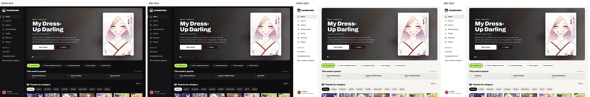
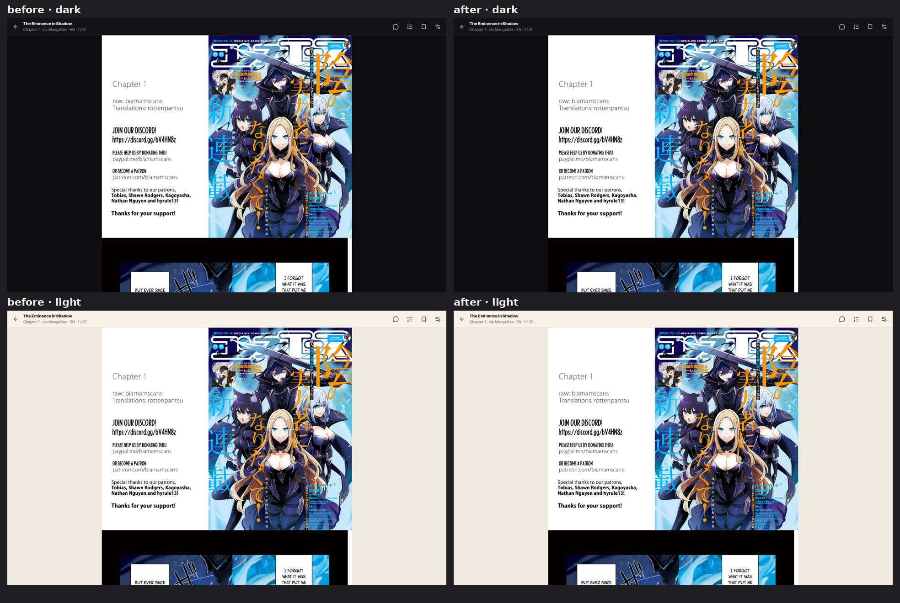

<div align="center">

  

  <h1>DAWGHWA</h1>
  <p><strong>Your next favourite story is out there.</strong></p>
  <p>Manga · Manhwa · Manhua · Webtoons</p>

  <p>
    <a href="https://github.com/titan717/dawghwa">
      
    </a>
    
    
    <a href="LICENSE"></a>
  </p>

  <p>
    <a href="docs/README.md">Documentation</a>
    &nbsp;·&nbsp;
    <a href="docs/ARCHITECTURE.md">Architecture</a>
    &nbsp;·&nbsp;
    <a href="docs/DESIGN.md">Design system</a>
    &nbsp;·&nbsp;
    <a href="https://github.com/titan717/dawghwa.api">API</a>
  </p>
</div>

<br/>

<div align="center">
  
</div>

---

## ✦ A reader, not a content warehouse

Dawghwa is a personalised discovery and reading app for manga, manhwa, manhua and webtoons. Find something worth reading, settle into a chapter, and pick up where you left off.

It is built as an **installable PWA** with an **Android app** — with a reader experience designed to keep the artwork front and centre.

## ◈ The good stuff

<table>
  <tr>
    <td width="50%" valign="top">
      <h3>⌕ Discover</h3>
      Explore catalogue sections, supported filters and natural-language discovery to find your next series.
    </td>
    <td width="50%" valign="top">
      <h3>▤ Read your way</h3>
      Choose vertical scroll, single-page, double-page or long-strip reading modes.
    </td>
  </tr>
  <tr>
    <td width="50%" valign="top">
      <h3>♡ Your library</h3>
      Keep your series, bookmarks, reading history, progress and profiles together on your device.
    </td>
    <td width="50%" valign="top">
      <h3>✧ Personal recommendations</h3>
      Optional recommendation learning happens locally on your device.
    </td>
  </tr>
</table>

## ◌ A peek inside

<div align="center">
  
  <br/><sub>Find a new series.</sub>
  <br/><br/>
  
  <br/><sub>Then get straight to the chapter.</sub>
</div>

## ⚙ Built with

<div align="center">
  
</div>

| Layer | Technology |
|:--|:--|
| App | React 19, TypeScript, Vite |
| Navigation | React Router |
| Data & persistence | TanStack Query, IndexedDB |
| Installable app | Vite PWA |
| Android | Capacitor 8 |
| Tests | Vitest, Testing Library, Playwright |

## 🚀 Run it locally

**Requirements:** Node.js 22+

```bash
git clone https://github.com/titan717/dawghwa.git
cd dawghwa
npm install
cp .env.example .env.local
npm run dev
```

Set `DAWGHWA_API_DEV` in `.env.local` if your API is not running on port `3100`.

The API lives in the separate [dawghwa.api](https://github.com/titan717/dawghwa.api) repository. To use the deployed API with the preview server:

```bash
DAWGHWA_API_DEV=https://dawghwaapi.vercel.app npm run preview
```

## 🧪 Checks

| Command | Purpose |
|:--|:--|
| `npm run typecheck` | TypeScript checks |
| `npm run lint` | ESLint |
| `npm test` | Unit and integration tests |
| `npm run eval:intel` | Recommendation evaluation |
| `npm run build && npm run e2e` | Production build and browser tests |

## 🔒 A note on privacy & content

- Dawghwa does **not** host content or run scrapers. Catalogue, chapter and page data are provided by the separate [Dawghwa API](https://github.com/titan717/dawghwa.api), which builds on [comick-source-api](https://github.com/GooglyBlox/comick-source-api) (MIT).
- Your library, history, progress, profiles and comments are stored locally in IndexedDB.
- Browsing and reading still make network requests to the API and content providers; local storage does not make those requests anonymous.
- The PWA can cache its app shell and covers. Chapter pages are not cached for offline reading.
- The optional four-digit PIN is a privacy curtain, not encryption.

## 📚 Project map

- [Documentation hub](docs/README.md)
- [Architecture notes](docs/ARCHITECTURE.md)
- [Design system](docs/DESIGN.md)
- [API repository](https://github.com/titan717/dawghwa.api)

---

<div align="center">
  
  <p><strong>One more chapter?</strong></p>
  <sub>Made for readers, and the stories that stay with us. 🐾</sub>
</div>

MIT licensed. Upstream credits are listed in the in-app About page.
