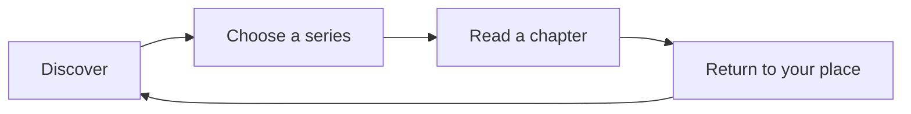

# Dawghwa

**Discover a series. Read at your pace. Pick up where you left off.**

Dawghwa is an installable PWA and Android reader for manga, manhwa, manhua, and webtoons. Recommendations are learned on your device.

Dawghwa does not host content or run scrapers. Catalogue, chapter, and page data come from the separate [Dawghwa API](https://github.com/titan717/dawghwa.api), which builds on [comick-source-api](https://github.com/GooglyBlox/comick-source-api) (MIT).

[Documentation hub](docs/README.md) · [Architecture](docs/ARCHITECTURE.md) · [Unified reader](docs/UNIFIED_READER.md) · [Design system](docs/DAWGHWA_DESIGN_SYSTEM.md)

## The reading flow



## What you can do

- **Discover:** Browse catalogue sections, use supported filters, or ask for a series in natural language.
- **Read:** Open a unified chapter list across linked providers, choose a chapter edition, and read vertically, as single or double pages, or as a long strip.
- **Pick up later:** Keep a local library, reading history, progress, bookmarks, and multiple isolated reader profiles.
- **Personalise:** Choose onboarding genres, adjust reader settings, and use optional on-device recommendations.
- **Make it yours:** Use optional rewards, profile colours, a reader card, and an optional four-digit PIN. The PIN is a privacy curtain, not encryption.

## Privacy and offline limits

Your library, history, progress, profiles, and comments are stored locally in IndexedDB on this device. Recommendations are learned on-device. Dawghwa still makes network requests to the API and content providers when you browse or read; local storage does not make those requests anonymous.

The PWA can cache its app shell and covers. Chapter pages are not cached for offline reading. Dawghwa is a client for content and metadata from its providers; it does not host that content.

## Run locally

Requires Node 22+.

```sh
npm install
cp .env.example .env.local
# Set DAWGHWA_API_DEV if your API is not running on :3100.
npm run dev
```

Run the API alongside this app in `dawghwa.api`:

```sh
npm run build
npx next start -p 3100
```

Or point the dev/preview proxy at the deployed API:

```sh
DAWGHWA_API_DEV=https://dawghwaapi.vercel.app npm run preview
```

## Quality checks

| Command | What it checks |
| --- | --- |
| `npm run typecheck` | TypeScript types |
| `npm run lint` | ESLint rules |
| `npm test` | Unit and integration tests (Vitest, fake IndexedDB) |
| `npm run eval:intel` | Recommendation evaluation report |
| `npm run build && npm run e2e` | Production build and Playwright checks |
| `npm run e2e:live` | Live reader checks; requires a running API |

## Android build

```sh
VITE_API_BASE_URL=https://your-api.example npm run android:build
```

The debug APK is written to `android/app/build/outputs/apk/debug/app-debug.apk`. Android builds require JDK 21 and Android SDK platform 36. A configured HTTPS API is required unless you intentionally set `ALLOW_NO_API=1` for a UI-only smoke build.

## API routes used

| Feature | Endpoint |
| --- | --- |
| Catalogue, Discover, structured search | `GET /api/catalog?provider=mangadex` |
| Filter vocabulary | `GET /api/catalog/filters?provider=mangadex` |
| Title details | `GET /api/titles/mangadex:{id}` |
| Multi-source title search | `POST /api/search` (NDJSON) |
| Unified chapters and pages | `GET /api/titles/{ref}/chapters/all`, `POST /api/chapters`, `POST /api/pages` |
| Content reports | `POST /api/reports` |

The catalogue provider is MangaDex, so catalogue IDs match the reader's MangaDex IDs. Queries are translated by `src/lib/api/catalog.ts`. Filters the API cannot apply are handled on-device when possible and identified in the interface; filters requiring unavailable catalogue metadata are not guessed.

## Project docs

See the [documentation hub](docs/README.md) for product, design, research, and engineering notes.

## License

MIT. Upstream credits are listed on the in-app About page.
